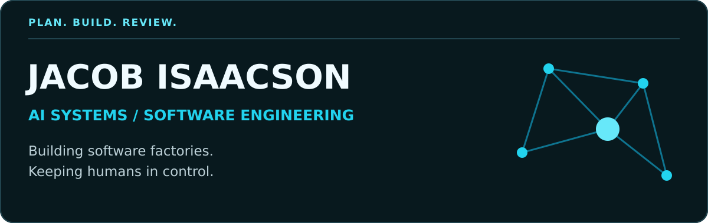
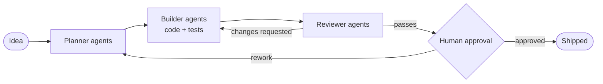

  <b>Senior Software Engineer · AI Agents · Software Factories</b> 
  I build backend systems and tools that help people turn ideas into working software.

  
  
  
  

---

## 🛩️ What I’m building

My current focus: coordinating AI agents across planning, implementation, review, and testing — with a human approving what ships. Everything is built to be model-agnostic: the same workflows run on Claude Code, Codex, and Kiro.

### Squadron — the software factory
An AI-powered software factory: planner, builder, and reviewer agents working together, with a human approving every change. *(Private)*

### Swarm Commander — the agent swarm
Portable multi-agent workflow definitions: specialist roles, structured handoffs, shared steering, and skills. One definition, any provider — Claude Code, Codex, and Kiro today. *(Private)*

### Flight Deck — the cockpit
The IDE you command the swarm from: multiple AI coding providers working side by side, with reviewed changes applied deliberately rather than blindly. *(Private)*

### Carbon Studios — the business
[carbonstudios.dev](https://carbonstudios.dev) — lead-generating websites, booking flows, and automation systems for local and professional service businesses in Utah. Engineered, not assembled.

## 🔧 Open-source work

### OperationKit · AI-review reliability

[View pull request #127 →](https://github.com/Axia-Growth/OperationKit/pull/127) 

Proposed a fix that prevents an AI review from recording success when its own checklist explicitly reports a failure. The contribution also preserves blocked results, improves a slow parser pattern, and adds regression and database integration tests.

Built with Claude Code, with testing details and tradeoffs documented in the pull request.

## 🧭 How I work

- **Humans approve, agents execute.** Automation does the legwork; people make the calls that matter.
- **Every change is reviewable.** Clear handoffs and small diffs beat a black box.
- **Trust is earned with tests.** A prototype becomes a product when it can prove it works.
- **No model lock-in.** Workflows, steering, and skills are portable across LLMs and providers.

## 🧰 Tools I work with

**Backend** 

**Web** 

**Systems** 

## 🚀 Public projects

A selection of my public repositories, ordered by their latest push. Private work is not included.

<!-- Generated daily by .github/workflows/recent-projects.yml. To add or remove a repo, edit scripts/public-projects.json (public repos only). If the list stops updating, re-enable the workflow in the Actions tab: GitHub pauses schedules after 60 days without repo activity. -->
<!-- RECENT-PROJECTS:START -->
- **[bookie2](https://github.com/jacoboi33/bookie2)** — JavaScript · Last push: 2026-05-19
- **[riffload](https://github.com/jacoboi33/riffload)** — Python · Last push: 2026-02-24
- **[interview-prep](https://github.com/jacoboi33/interview-prep)** — HTML · Last push: 2026-02-19
- **[asteroids](https://github.com/jacoboi33/asteroids)** — asteroids game in python · Last push: 2025-01-18
- **[go-time](https://github.com/jacoboi33/go-time)** — go cli tool for tracking time · Last push: 2024-11-15
<!-- RECENT-PROJECTS:END -->

[Browse all repositories →](https://github.com/jacoboi33?tab=repositories&sort=updated)

---

  <i>I’m especially interested in reliable AI-assisted development, useful automation, 
  and the engineering that turns a promising prototype into something people can trust.</i>

